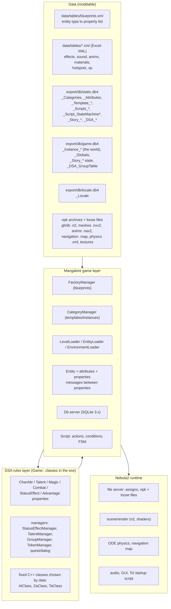
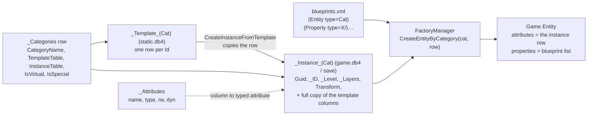
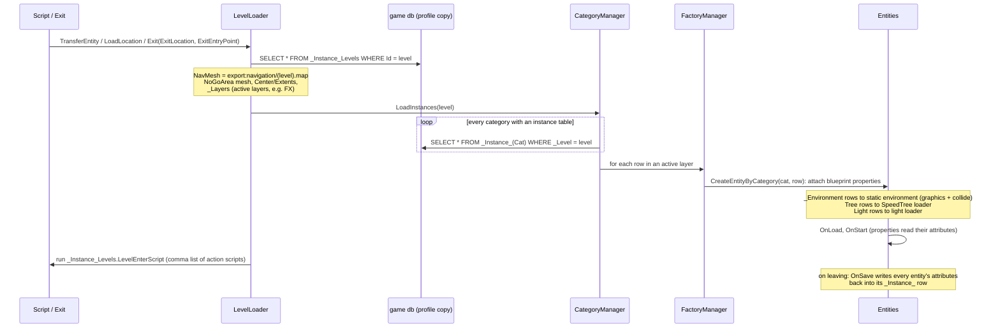
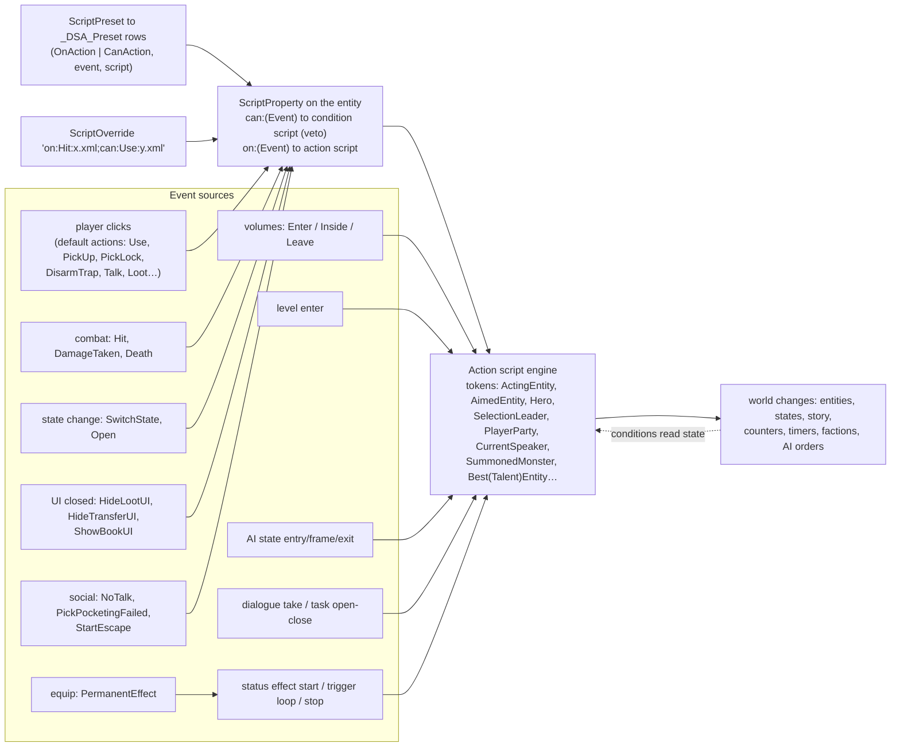
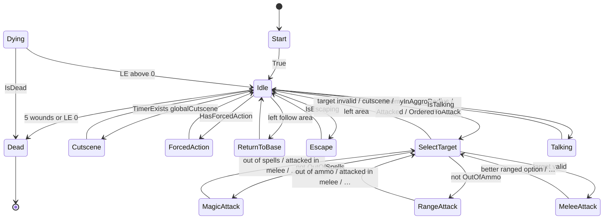
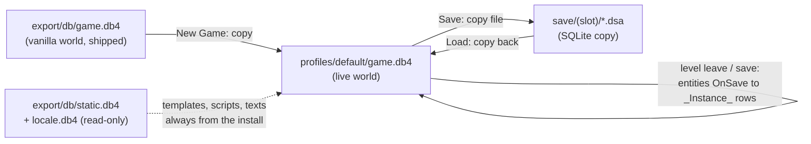
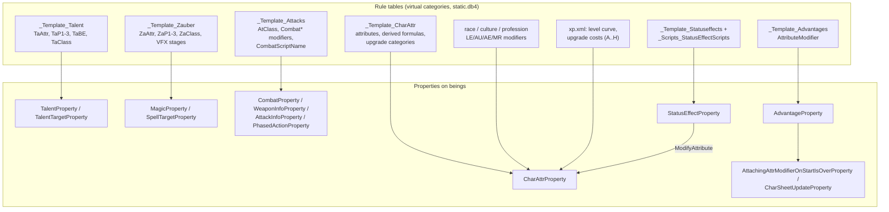

# Engine architecture: how Drakensang works, and where data can hook into it

How the engine works, mapped from the game's own data (read from the player's copy, nothing of it shipped here),
`docs/ENGINE_REFERENCE.md` (player-verified facts), and the public Radon Labs Nebula3 SDK game layer (`basegamefeature`, `addons/db`), which is the
direct descendant of the Mangalore layer Drakensang runs on (same `_Categories` / `_Template_*` / `_Instance_*` /
`_Attributes` schema). The executable was not touched.

**Evidence tags used below**
- **verified (data)**: read directly from the databases/files here.
- **verified (game)**: proven in play, copied from `ENGINE_REFERENCE.md`.
- **verified (N3 source)**: the public Nebula3/Mangalore code does exactly this, and the Drakensang data has the same shape.
- **inferred**: follows from the data/source, not observed.
- **needs in-game test**.

Generate the full listings from your own copy with the tools in `tools/engine/` (see [Tools](#tools)): every property class with
its attributes (`engine_map.py`), all 898 attributes, and every action verb, condition atom and hook event with counts and
examples (`vocab.py`). They are not in this repository because they quote the game's data.

---

## 1. The layers



What this means for modding: everything in the top box is read at runtime and can be changed; the classes in the middle
boxes are fixed. "New systems" therefore means **new combinations** of existing classes, driven by new rows: new scripts,
new state machines, new triggers, new presets, new entity instances, new property combinations (blueprints).

---

## 2. Boot and file system

| Step | What happens | Evidence |
|---|---|---|
| Nebula2 starts | `data/scripts/startup.tcl` `OnStartup` sets the assigns `export:` = `proj:/export/`, `data:` = `export:data/`, `gfxlib:`, `meshes:`, `textures:`, `anims:`, `physics:`, `levels:`, `shaders:`, `sound:` = `export:audio` | verified (data) |
| Archives | `export*.npk`, `hightextures*.npk`, `locale.npk`, `patch1.npk` are mounted over `export/`. `patch1.npk` re-ships `locale.xml`, `generated_types.xsd`, shaders and some gfx: later archives win | verified (data, `npk_index.csv`) |
| Loose files | a file present under `export/` overrides the archive copy | verified (game) for `textures/icons`; **needs in-game test** for `data/tables/*.xml` |
| Databases | static (`export:db/static.db4`) opened read-only; `game.db4` copied into the profile on New Game (see §8) | verified (N3 source), verified (game) |
| Attributes | `_Attributes` is read first: every row whose name the exe does not know is registered as a dynamic attribute ("enables an application to function even without knowing all attributes beforehand", `sqlite3database.cc`) | verified (N3 source) |
| Categories | `_Categories` (90 rows) is read; template tables are loaded into memory | verified (N3 source + data) |
| Blueprints | `data:tables/blueprints.xml` is parsed; each `<Entity type>` lists property class names created by RTTI name (`Core::Factory::Create(type)`) | verified (N3 source + data) |
| Runtime XML tables | `effects.xml` (350 VFX names → gfx file + timeout + hotspot), `sound.xml` (167), `soundeffects.xml`, `hotspots.xml`/`hotspoteffects.xml` (bone attach points per skeleton), `materials.xml` (physics materials, friction, bounce, sound), `anims.xml` (648 logical anim states × 84 anim sets), `xp.xml` (level curve, quest XP, upgrade cost tables) | verified (data); runtime loading **inferred** (no db copy of these tables exists) |

`globals.xml` was converted into `game.db4: _Globals` (101 columns = 101 rows of the sheet); the db copy is the one in
the save, so global tuning values (`XpMultiplicator` 2.0, `LevelCap` 20, hit-zone chances, `CorpseDespawnTime`, party
follow radii, `Malus_Selbstbeherschung_ResistingWounds` …) are **per save** (inferred from location; verified (data)).

The other `data/tables/db/*.xml` (Excel workbooks) are the designers' sources that an offline tool (`dsaxmltodb`, empty log
in `export/`) compiled into the `.db4` files. The game reads the `.db4`, not these (verified (game): every working mod edits
only the db).

---

## 3. Entities, properties, attributes



- **Entity** = a bag of typed **attributes** (one db row) + an ordered list of **properties** (C++ behaviour objects). An entity
  has no class of its own (`cppclass="Entity"` for all 61 types). verified (data + N3 source)
- **Property** = a C++ class with `SetupDefaultAttributes`, `OnActivate`, `OnLoad`, `OnStart`, `OnSave`, `OnBeginFrame`,
  `OnMoveBefore/After`, `OnRender`, `HandleMessage`. Properties talk to each other through **messages** sent to the entity
  (the entity owns a message dispatcher; every property is a message port). Order in the blueprint matters: comments in
  `blueprints.xml` say e.g. "CombatProperty must be triggered before the PhasedActionProperty", "LevelSwitchableProperty ALLWAYS
  MUST BE LAST". verified (data + N3 source)
- **Category** = a named entity type: blueprint name = category name. Template rows define kinds of things (`Id`), instance
  rows place them in the world (`Guid` PK, `_ID` = `|Level|Objects|<Cat>|<Name>` or `|Level|Environment|…`, `_Level`).
  Instances carry **all template columns again**: the engine copies the template row when an entity is created at runtime
  (`CreateInstanceFromTemplate`), so per-instance overrides of any template column are normal (e.g. one NPC with a different
  `Behaviour` or `ScriptPreset`). verified (data + N3 source)
- **Virtual categories** (27: `Talent`, `Zauber`, `Attacks`, `Statuseffects`, `Faction`, `Groups`, `Levels`, `race`, `token`, …)
  have only a template table: they are rule tables, not entities. **Special categories** (`Light`, `_Environment`, `Levels`)
  are loaded by dedicated loaders. verified (data)
- Consistency (from `engine_map.py`): `VisibilityBox` (443 instances), `Lights` (0) and `_Environment` have instances but no
  blueprint, so Drakensang's entity loader must skip them like N3 skips `Tree` and `_Environment` (inferred); `WorldMapGraphic`
  is a blueprint without category; 10 blueprints have no property at all (`Tree`, `Backup`, `ActionDummy`, world-map types).
- **New columns need an `_Attributes` row** in both dbs (name, type `string|int|float|bool|vector3|vector4|matrix44|guid|blob`,
  `AttrReadWrite`). Without it the column has no attribute type. Only C++ code reads attributes by name, so a new column is
  inert unless an existing mechanism reads it (`ModifyAttribute` takes any attribute name: **needs in-game test** for a custom
  one). `AttrDynamic` is not read by the N3 code; in the vanilla data it is 0 for exactly the 102 Mangalore core attributes, so it most likely marks attributes declared by the DSA layer rather than compiled into the engine (**inferred**).

### Entity types at a glance (verified (data))

| Group | Entity types | Key properties |
|---|---|---|
| Beings | `PC` (49 props), `NPC` (42), `Monster` (36), `MonsterLarge` (31), `PC_CharWizard` (20) | CharAttr, StatusEffect, Combat, PhasedAction, Behaviour, Script, Talk, Faction, Group, Roaming, Magic, Talent… |
| Carried items | `Weapon`, `Shield`, `Armor`, `Jewelry`, `Ammo`, `Item`, `Recipe`, `Book`, `Key`, `Money`, `Torch` | Storable*, Equipable, PermanentEffect, Useable, Script, Lootable, Tradeable, QuestItem |
| Stateful world objects | `Door`, `Switch`, `StateObject`, `Chest`, `DestroyableEntity`, `Herb`, `WorkBench`, `BookStand` | State, StatePhysics, StateGraphics, Useable, Script, Lock, Trap, Storage, Destroyable |
| Volumes / sensors | `Trigger`, `Trap`, `EncounterTrigger`, `AreaSpellTrigger`, `GardianumReflector`, `MusicTrigger`, `GroundTypeBox`, `AmbienceBubble`, `Exit` | Trigger, TrapTrigger, EncounterTrigger, AreaSpellTrigger(+StatusEffect), ExitTrigger |
| Points / markers | `Entry`, `MarkerPoint`, `SpawnPoint`, `PathWaypoint`, `TalkPoint`, `MapSegment`, `Blockade` | Transformable, Entry, Spawnpoint, Waypoint, NavigationBlockade |
| Presentation | `Light`, `PostEffects`, `Camera`, `CutsceneCamera`, `SoundObject`, `Annotation`, `EffectBox`, `FlimFlamFunkelLight` | Light, PostEffect, PathAnim, SoundObject, CharacterLight |
| World map | `WorldMapCamera`, `WorldMapPath`, `WorldMapPlayerParty`, `LocationButton`, … | none in blueprints (handled by the world-map code) |

---

## 4. How a level loads



- Instances are selected **only by `_Level`** (indexed column). Moving an entity between levels = changing its `_Level`
  (`TransferEntity entity= location= entryPoint=`). verified (N3 source); `TransferEntity` across levels verified (game).
- **Parking levels**: `_graveyard_`, `_nirvana_`, `_garbage_` exist as level names; vanilla parks characters in `_graveyard_` and
  brings them in later. `currentencounter` is the level used for random encounters (`_Template_RandomEncounters`). verified (data/game)
- `GetInstancesByAttr` can pull an instance from the database that is not in the current level (e.g. by `Name`), which is
  how scripts address characters elsewhere. verified (N3 source); used by `TransferEntity` (inferred).
- **Layers**: entities whose `_Layers` is non-empty load only if that layer is active in the level row. Vanilla uses only
  `FX` (6065 environment rows, 608 sounds, 178 ground boxes); no script verb switches layers. verified (data)
- **`LevelEnterScript`** (`_Instance_Levels`, 6 vanilla levels): a comma-separated list of action scripts run on entering the
  level, e.g. Ferdok runs `on_fail_quests_loc05.xml,on_fail_quests_loc04.xml,…`. verified (data); timing "on every enter" inferred.
- Entry points: `_Instance_Entry` (1570 rows, `EntryPortalParty`/`EntryPortalObject`); exits: `_Instance_Exit` with
  `ExitLocation`, `ExitEntryPoint`, `FallBackEntry`, `EntityFilter=IsPartyLeader;`. verified (data)

---

## 5. Scripts, events and the message flow

### 5.1 Script storage

All logic is rows (details and encoding in `ENGINE_REFERENCE.md` §4):

| Container | Table | Entry point |
|---|---|---|
| Action script | `_Scripts_ActionScripts` (6203) | `ScriptName` → `Begin` statement |
| Condition script | `_Scripts_ConditionScripts` (89) | `ScriptName` → condition row |
| Status effect | `_Scripts_StatusEffectScripts` (109) | Start / Trigger (loops) / Stop blocks |
| State machine (AI) | `_Script_StateMachines` (62), `…States` (506), `…StateTransitions` (1019) | §6 |
| Dialogue | `_Story_Dialogs`, `_Story_DialogTakes`, `…ChildMapping`, `…Conditions`, `…Actions` | take conditions/actions |
| Quest | `_Story_Tasks` + open/close conditions/actions | open/close blocks |
| Inline strings | Trigger/Trap `EnterActions/LeaveActions/InsideActions`, `EntityFilter`, task/dialog action rows | action/condition text |

Statement types: `Begin`, `Action`, `If`, `Then`, `Else`, `Condition`; condition rows: `Atom`, `Not`, `And`, `Or`, `Condition`
(verified (data): 32070 statements, 15229 condition rows). Named sub-blocks exist: `script="X.xml_poisonbreath"`,
`SetScript_X.xml_3`, used by `RunScriptOnAllInside`, `SetForcedActionScript`, `LoopAction` (verified (data)).

### 5.2 Where scripts are triggered (hook points)



Hook events seen in data (verified (data), full table: `tools/engine/vocab.py`):

| Event | `on:` used by | `can:` used by | Token meaning (from vanilla scripts) |
|---|---|---|---|
| `Use` | Item (219), StateObject (58), Switch (43), Chest, Door, Object, Book, BookStand, Herb, Recipe, WorkBench | Item (`can_use_charged_item.xml`), Door, DestroyableEntity, Recipe, WorkBench (`can_use_talent_alchemy.xml`) | ActingEntity = user |
| `Hit` | Weapon (17), Ammo (15), NPC preset (1) | artefact preset (`artefact_hascharge.xml`) | AimedEntity = victim |
| `DamageTaken` | NPC, Monster, MonsterLarge, DestroyableEntity (presets) | – | AimedEntity = the damaged entity, ActingEntity = attacker (`loc05_on_hit_swap_target.xml`) |
| `Death` | DestroyableEntity, Monster, NPC, MonsterLarge | – | |
| `TriggerTrap` | Trap (153), Chest, Door, DestroyableEntity | Chest/Door/Destroyable (`is_trap_active.xml`) | |
| `Open` | Chest | (unused preset) | |
| `SwitchState` | StateObject | – | |
| `HideTransferUI`, `HideLootUI`, `ShowBookUI` | Chest, DestroyableEntity, Herb, Book | – | |
| `NoTalk`, `PickPocketingFailed` | NPC, Monster | – | ambient barks, guards reacting |
| `StartEscape` | (chicken preset) | – | |

Rules (verified (data) unless noted):
- `ScriptPreset` names a preset; `_DSA_Preset` (547 rows) expands it into several `(OnAction|CanAction, event, script)` pairs.
  `ScriptOverride` gives the same pairs inline (`on:Use:x.xml;can:Use:y.xml`). Weapons/ammo/items/traps use overrides,
  beings and containers use presets.
- Armour `on:Hit` never fires (verified (game)): the event must be one the entity's properties actually raise.
- Every action carries `actionSelection` (`script`, `quest`, `dialog`, `hook`: which contexts may run it), most take `track`
  (0–6: parallel action lanes per entity, inferred from `CutsceneWaitForTimer`/`PlayAnimation` usage) and some `executeAfter="true"`
  (run when the dialogue closes, verified (game)).
- Trigger `EntityFilter` accepts general condition atoms, not only the four "trigger conditions": vanilla filters use
  `IsTaskClosed`, `CompareCounter`, `IsInInventory`, `IsInLocation`, `IsInRange`, `CanScript scriptNames=` (any condition script)
  and `not=true`. Trigger action strings accept ordinary verbs (`OnScript`, `RunActionScript`, `ForceDialog`, `SetTriggerActive`,
  `SwitchState`, `TransferEntity`, `UnlockQuest`…).
- Global state for scripts: **counters** (`AddToCounter`, `RandCounter`, `ResetCounter`, `CompareCounter`: 2829 tests),
  **timers** (`StartTimer`, `TimerExists`, `CompareTimer`, `ResetTimer`), quest/task/dialog state, entity `State`, factions,
  groups. Counters/timers are not in vanilla `game.db4`; they must be created in the save at runtime (inferred; check with
  `save_diff.py` on a real save).
- `ModifiedOutside description="<who changes it>"` is the condition of tasks that never open/close by themselves: the first
  quest opens with `ModifiedOutside description="trigger_loc01"`, i.e. only an action (`UnlockTask`, a trigger script) changes
  it (67 uses; meaning inferred from use). Mod quests driven purely by scripts should use the same atom.
- Long-running scripts: `WaitAction duration permanent`, `WaitForCondition condition="x.xml" duration permanent="true"`,
  `LoopAction script= conditionRef= conditionBlock=`, `CutsceneWaitForTimer`.

### 5.3 Messages

The C++ message classes cannot be listed without the exe. What the data shows is the layer above them: an event name
(`Use`, `Hit`, `DamageTaken`, …) is what a property broadcasts and what `ScriptProperty` matches against its `on:`/`can:` table;
a mouse click is turned into one of the 19 **default actions** (`_Template_defaultactions`: `Actions::Use`, `Actions::PickLock`,
`Actions::DisarmTrap`, `Actions::GatherHerbAction`, `Actions::SkinAnimalAction`, `Actions::HitDestroyableEntity`, …), which the
`PhasedActionProperty` executes and which then raises the event (inferred). Data cannot add a new event type; it can attach
scripts to every existing one.

---

## 6. AI and behaviour

AI is **data-driven finite state machines** (verified (data)). A being's `Behaviour` column names a machine in
`_Script_StateMachines` (`Id`, `StartState`); each state has entry/frame/exit statement blocks; transitions are ordered
(`TransitionIndex`) and fire on a condition, optionally running a statement block. `BehaviourProperty` evaluates them.

Use in vanilla: NPC `simple_fighter` 1077, `stupid_fighter` 254, `clever_fighter` 35, `cast_always` 9; Monster `stupid_fighter`
120, `simple_fighter` 46, `basic_harmless` 25, `static_fighter` 8; PCs `pc_simple2`. Story machines: `loc08_beh_tatzelwurm`,
`loc12_beh_malgorra_monster`, `loc11_beh_grolmenkoenig`, `loc01_guards`, `behavior_heidruna`… 37 machines are never referenced by a
`Behaviour` column (`basic_combat`, `clever_combat`, `mage_combat`, `monster_wolf`, `watchdog`, …) and `basic_monster` is
referenced by 3 monsters but does not exist (they presumably fall back to a default, inferred).

`clever_fighter`, decoded with `dsa_script.py fsm clever_fighter`:



The knobs live in the statements (verified (data)):
- `SelectTarget onceARound aggroWeighting dangerLevelWeighting distanceWeighting numberAttackersWeighting isAttackerWeighting
  actualTargetWeighting liveEnergyWeighting astralEnergyWeighting armourWeighting rangedWeighting isElfWeighting isDwarfWeighting
  randomWeighting`: the whole target-priority formula is data.
- `CombatActionGenerator SpecialAttackChances="Finte 3.0 0, …" SpecialParryChances SpecialRangeAttackChances CombatSpellChances
  UseDefaultAttack`: weighted move choice; NPC columns `SpecialAttackChances` / `CombatSpellChances` exist too.
- Movement/orders: `MoveIntoAttackRange`, `MoveIntoMagicAttackRange`, `ReturnToSaveArea`, `OrderMyGroupToAttack`, `StartEscape`,
  `EquipBestCloseRangeWeapon`, `EquipBestRangedWeapon`, `RunBaseAction`.
- Death rule: `Dead` when `HasStatusEffect id="wound" amount="5"` or `HealthCritical value="0"`; `Dead` entry sets status `death`
  and `GiveCombatXp` if `WasAttackedByPlayer`. So **combat XP is granted by the AI script**, not hard-coded.
- Out-of-combat life: `BaseActionScript` (an action script run as the idle activity, e.g. `roaming_01.xml` = `SetWalking;
  PerformRoaming`), changed at runtime by `SetBaseActionScript` (1386 uses); `SetForcedActionScript` pushes a one-off script
  (state `ForcedAction`). Patrols = `PerformFollowPath` over `_Instance_PathWaypoint` (2451).
- Sides: `Faction` (matrix `_Template_Faction`, one column per faction holding `Friendly/Neutral/Hostile`), `SetFaction`,
  `SetReputation`, `CheckReputation`; groups (`_Template_Groups`, `IsCombatGroup`, runtime membership `game.db4: _DSA_GroupTable`)
  for "attack together" and `IsGroupDead`.
- State vocabulary (all machines): Start, Idle, SelectTarget, MeleeAttack, RangeAttack, MagicAttack, Escape, ReturnToBase,
  Talking, Cutscene, ForcedAction, Dying, Dead, plus custom ones in story machines (BuffAlly, HealAlly, Summon, Howl, Snarl,
  Surrender, CloseDoor, ChickenChase, RunAround…). Custom state names are therefore free. verified (data)

---

## 7. Navigation and physics

**Navigation** (verified (data) unless noted)
- One nav map per level: `_Instance_Levels.NavMesh = export:navigation/<level>.map` (66 files, 89 MB) plus a no-go mesh
  `meshes:nogoarea/<level>_nav_0.nvx2` with its transform. The `.map` is a binary node graph (header `-1,-1,16,2,<count>`,
  then nodes with float positions and neighbour lists; not decoded here, belongs to the formats track).
- Runtime blocking: `NavigationBlockadeProperty` on `Blockade` (67 instances) and `DestroyableEntity` (`BlockadeShape`,
  `BlockadeIsActive`); scripts `ActivateBlockade` / `DeactivateBlockade` (87 uses). This is how gates/barricades cut paths.
- Paths and roaming: `PathWaypoint` chains (`WaypointPathName`), `PerformFollowPath`, `PerformGoto`, `PerformRoaming` within
  `RoamingRadius`-style home data (`RoamingBasePosition`, verified (game)). `_Globals.MaxPathLength` 100.
- Areas for scripts: `IsInside who edge1..edgeN` and `IsMostOfGroupInside group segment edge0..4` test polygons made of
  `MarkerPoint` names; `RunScriptOnAllInside` runs a script on everything inside. These are a free-form "zone" system.

**Physics**
- ODE through Nebula2 (inferred from Mangalore). Each `Physics` attribute names `export/physics/<path>.xml` (2325 files):
  `<Composite>` of `MeshShape`, `BoxShape`, `CapsuleShape`, `SphereShape`, `RigidBody`, joints `Hinge`/`BallAndSocket` (doors,
  lids). Materials referenced by name: `Soil`, `Wood`, `Stone`, `Metal`, `Ice`, `Flesh` (defined in `materials.xml` with density,
  friction, bounce and impact sound matrices).
- `PhysicCategory` (`Environment`, …) on world objects; `StatePhysicsProperty` swaps collision per state; `BeingPhysicsProperty`
  (character capsule), `LargeMonsterPhysicsProperty` for big monsters.
- Trigger volumes are physics shapes too (`dummies/sphereshapetrigger`, `dummies/boxshapetrigger`, `Shape` sphere|box, scaled by
  the instance `Transform`).

**State objects**: the states are defined in the `.n2` gfx, not in the db: `stateobjects/chest_schatztruhe_01.n2` contains an
`rlStateObject` node with child states `Closed`, `Opening`, `Open`, `Closing`, `rlTransitions`, `rlTransitionTime`, `rlSound`
and per-state animations. The db only stores the current `State` and scripts call `SwitchState entity= state=`. A new state
object needs a gfx with the wanted state names (verified (data)).

---

## 8. Save games



verified (N3 source: `DbServer::OpenNewGame / CreateSaveGame / OpenLoadGame` copy the file) and verified (game)
(`ENGINE_REFERENCE.md` §1, §12).

What a save contains:
- Every `_Instance_*` table for **all** levels (the whole world, not only visited levels), rewritten as entities save.
- Story state: `_Story_Tasks(TaskId, TaskState)`, `_Story_Dialogs(DialogId, DialogLocked)`, `_Story_DialogTakeStatus`.
- `_Globals` (one row, incl. `CurrentLevel`-type values), `_DSA_GroupTable`, `_Attributes`.
- Tables/columns created at runtime: e.g. `_PartyReceipes` (learned recipes) is absent from vanilla `game.db4` but present in
  saves (verified (game)); character columns like `KnownRecipes`; counters/timers (inferred).
- What it does **not** contain: templates, scripts, AI machines, dialogue/quest definitions, loot tables, texts. Those always
  come from the installed `static.db4`/`locale.db4`, which is why template/script mods apply to old saves while placed content
  does not.

Consequences for modding: any hook stored in an **instance** row (`LevelEnterScript` in `_Instance_Levels`, a new trigger, a
changed NPC `Behaviour` on the instance) needs a new game or a save patch (`tools/maint/sync_save_world.py` in the mod repo);
anything stored in **static** tables (scripts, presets, FSMs, templates) is live for existing saves. Prefer static-side hooks.

`tools/engine/save_diff.py` lists exactly what a given save added (runtime tables, new columns, rows per table/level, story
state, BLOB-in-TEXT problems).

---

## 9. The DSA rules layer



- The rules are DSA 4 (Das Schwarze Auge): 3d20 probes against three attributes (`TaP1..3`, `ZaP1..3`), AT/PA, TP dice
  (`WpW6`, `WpW6plus`), BE, wounds, LE/AU/AE, MR. verified (data); spell probe redirection to `LEmax` verified (game).
- **Data chooses among fixed C++ classes**: 51 `AtClass` values (`Game::Finte`, `Game::Wuchtschlag`, `Game::ScriptCombatAction`,
  `Game::TatzelwurmAttack`, `Dummy::Ausweichen1` for passive SF…), 46 `ZaClass` (one class per spell), 8 `TaClass` (active
  talents: `PickPocket`, `LockPicking`, `GatherHerbs`, `SkinAnimals`, `HealWounds`, `HealPoison`, `Entrapment`,
  `DisarmTrapTalent`; the other 29 talents are `InvalidClass`, i.e. passive values). A new spell/attack/talent can reuse a class
  with new numbers but cannot get new code.
- **`Game::ScriptCombatAction` is the exception**: its behaviour is the action script in `CombatScriptName`. Vanilla:
  Tatzelwurm, Purpurwurm, Malgorra special attacks. This is the only data-defined combat move type. verified (data)
- Attack modifiers are columns: `CombatDamageMulti`, `CombatUseOverthrown`, `CombatUseStun`, `CombatAdditonalWounds`,
  `CombatIgnoreArmor`, `CombatArmorPenetrationModifier`, `CombatPoisonName`, `CombatBuffStatusEffect`/`CombatBuffTime`/
  `CombatBuffBonus`/`CombatBuffAuCostPerRound`, `CombatCoolDownPhases`, `CombatBallisticVfx`, `AU`, `XP` (learning cost),
  `SkillRequirements`.
- Status effects are the general-purpose buff/debuff/aura/DoT mechanism (scripts with start/loop/stop, categories, immunities;
  rules and crash cases in `ENGINE_REFERENCE.md` §4 and §9).
- Character build: `_Template_PC_CharWizard` archetypes, `_Template_Advantages.AttributeModifier` (`TaDolche:+2;`), race/culture/
  profession base modifiers, `xp.xml` (`CharLevelXP` 29 levels, `AttrUpgradeCategories` attribute→cost column A–H,
  `AttrUpgradeXPCost`). `_Globals.LevelCap` 20, `XpMultiplicator` 2.0.

---

## 10. Glossary of property classes (122)

Role descriptions are **inferred** from the class name, the entity types that carry it, the columns attributed to its group
(`tools/engine/engine_map.py` output) and the scripts that touch it. Entity counts are verified (data).

| Property | Carried by | Role |
|---|---|---|
| ActionPlayerProperty | PC, NPC, Monster, MonsterLarge | plays actions/animations ordered by scripts (PlayAnimation, MoveStop…) |
| AdvantageProperty | PC, PC_CharWizard | applies `Advantages` (`_Template_Advantages.AttributeModifier`), archetype/culture/profession data |
| AmbienceBubbleProperty | AmbienceBubble | sphere that blends post-effect/fog/sky/light settings while the camera is inside; `EnableAmbientBubble` |
| AreaSpellTriggerProperty | AreaSpellTrigger | runtime area of a spell (Aerofugo, Gardianum, Tlalucs Odem) applying status effects to beings inside |
| ArmorProperty | Armor | armour values (zone protection `RSKo` head … `RSRB` right leg, `ArGes`, `ArBE`, `ArMaterial`) and which body meshes it hides/replaces (`Torso`, `Arme`, `Haende`, `Beine`, `Fuesse`, `Haare`) |
| AttachingAttrModifierOnStartIsOverProperty | beings | re-applies attribute modifiers after start-up (blueprint comment: after all attribute properties) |
| AttackFormationProperty | PC, NPC, Monster, MonsterLarge | combat spots around a target (`AttackFormation`, `RotateAttackFormation`, `CombatSpotOffset`) |
| AttackInfoProperty | PC, PC_CharWizard, NPC | known special attacks/SF list for the being |
| BehaviourProperty | PC, NPC, Monster, MonsterLarge | runs the `Behaviour` state machine (§6) |
| BeingAnimationProperty | beings | anim set (`AnimSet`, `anims.xml` mapping), base/overlay animations |
| BeingGraphicsProperty | beings | character model (`CharacterSet`, skins) |
| BeingLookProperty | Monster, MonsterLarge | look-at text / name display for monsters |
| BeingPhysicsProperty | PC, NPC, Monster | character collision capsule, movement |
| BeingSoundAndEffectProperty | beings | step/hit/voice sounds and hit VFX (`soundeffects.xml`, `hotspots.xml`) |
| BookUserInterface | Book, BookStand | opens the book reader (`ShowBookUI`) |
| CharAttrProperty | beings | DSA attributes and derived values (LE, AU, AE, AT, PA, MR, INI…); "should be one of the first" |
| CharSheetUpdateProperty | PC, PC_CharWizard, NPC | recomputes the character sheet after all attribute changes |
| CharacterLightProperty | Torch, FlimFlamFunkelLight | light carried by a character (torch, Flim Flam spell light) |
| CombatProperty | PC, NPC, Monster, MonsterLarge | combat rounds, AT/PA resolution, wounds |
| CommandGraphicsProperty | PC | move/target markers for player commands (cursor meshes) |
| CraftProperty | PC, PC_CharWizard | recipes known, crafting (`KnownRecipes`) |
| DeathProperty | NPC, Monster, MonsterLarge | death handling, corpse, `on:Death` event |
| DestroyableProperty | DestroyableEntity | breakable object with `LE`, `DamageReduction`, `CanBeAttackedInMelee` |
| DsaAnnotationProperty | Annotation | editor/debug annotation object |
| DsaCharSkinProperty | PC, PC_CharWizard | skin lists / appearance (`SetSkinlist`) |
| DsaCutsceneCameraProperty | CutsceneCamera | cutscene camera paths (`SetCutsceneCamera`, `AddToCutscene`) |
| DsaInputProperty | PC_CharWizard, CutsceneCamera | input handling in the character wizard / cutscenes |
| DuplicatusGraphicsProperty | PC | mirror image for the Duplicatus spell |
| EmoteProperty | PC, PC_CharWizard, NPC, Monster | emote animations (`_Template_Emote`) |
| EncounterTriggerProperty | EncounterTrigger | volume that starts an encounter (spawns via SpawnPoints, groups) |
| EntryProperty | Entry | arrival point for level transfers |
| Equipable | Torch, Weapon, Shield, Armor, Jewelry, Ammo | equips into slots (`_Template_equipmentSlots`, `_Template_slots`) |
| ExitProperty | Exit, ExitObject | level exit (`ExitLocation`, `ExitEntryPoint`, `FallBackEntry`, `LocationChange`) |
| ExitTriggerPickingProperty | Exit | makes the exit volume clickable |
| ExitTriggerProperty | Exit | exit volume (filter `IsPartyLeader;`) |
| FactionProperty | PC, NPC, Monster, MonsterLarge | `Faction` membership and stance lookup (`_Template_Faction`) |
| GardianumReflectorProperty | GardianumReflector | Gardianum spell shield object |
| GraphicsProperty | Object, ExitObject, Annotation, AreaSpellTrigger | static graphics from `Graphics` |
| GroundTypeProperty | GroundTypeBox | ground type for footsteps/VFX (`gras`, `stone`…) |
| GroupProperty | PC_CharWizard, NPC, Monster, MonsterLarge | group membership (`SetupGroups`, `_DSA_GroupTable`) |
| HealthBarGraphicsProperty | NPC, Monster | health bar over enemies |
| InputProperty | RemoteCamera, Camera | camera input |
| Inventory | NPC, Monster, MonsterLarge | carried storage (`SetupStorage`, `SetupEquipment`) |
| ItemLookProperty | Recipe, Book, BookStand, Torch, Key, Armor, Jewelry | name/description/icon display |
| LargeMonsterPhysicsProperty | MonsterLarge | collision for big monsters (dragons, Tatzelwurm) |
| LevelSwitchableProperty | 21 types | lets the entity move between levels (`TransferEntity`); "ALLWAYS MUST BE LAST" |
| LightProperty | Light | placed light source |
| LockProperty | Door, Switch, Chest, DestroyableEntity | lock (`IsLocked`, `LockId`, `LockPickingDifficulty`, `HasKey`) |
| LookAtProperty | NPC | head tracking (`EnableLookAt`) |
| LookProperty | 16 types | look-at text / name on hover |
| LootUserInterface_Mangalore | PC, NPC, Monster, MonsterLarge, DestroyableEntity, Herb | loot window |
| LootableItem | carried items | item can be looted (`Lootable`) |
| LootableProperty | PC, NPC, Monster, MonsterLarge, Chest, DestroyableEntity, Herb | entity can be looted (`LootTable`, `IsLootable`) |
| MagicProperty | PC, PC_CharWizard, NPC, MonsterLarge | spell casting, AE, `Za*` values |
| MapDisplayProperty | 19 types | marker on the minimap/location map (`TrackByMiniMap`, `_Template_maplegend`) |
| MapSegmentProperty | MapSegment | location-map tile |
| Money | Money | money item |
| MoneyLookProperty | Money | money display |
| MusicTriggerProperty | MusicTrigger | music cue volume (`CueName`, `MusicCategory`) |
| NavigationBlockadeProperty | DestroyableEntity, Blockade | cuts the nav map while active (§7) |
| NpcPartySelectionProperty | NPC, Monster | selection highlight for non-party beings |
| OverHeadTextProperty | 11 types | floating text (`ShowOverHeadMessage`, damage numbers) |
| PCStorageUserInterface | PC | party inventory window |
| PartyBandProperty | PC, NPC, Monster | party ribbon / companion display |
| PartyCameraProperty | PC, PC_CharWizard | party camera |
| PartySelectionInputProperty | PC | party selection input |
| PartySelectionProperty | PC, PC_CharWizard | selection leader, party selection |
| PathAnimProperty | Light, Camera, CutsceneCamera | animated paths |
| PcGroupProperty | PC | player party group (before PartySelectionProperty) |
| PcUserInterfaceProperty | PC | portrait/HUD binding |
| PermanentEffectProperty | Weapon, Shield, Armor, Jewelry | status effects while equipped (`PermanentEffect`) |
| PhasedActionProperty | PC, NPC, Monster, MonsterLarge, StateObject, Chest, DestroyableEntity | executes timed actions (use, pick lock, attack phases) |
| PhysicsProperty | Object, ExitObject, Annotation | static physics from `Physics` |
| PickingProperty | PC, NPC, Monster, MonsterLarge | mouse picking of beings |
| PlayerInventory | PC, PC_CharWizard | hero inventory and equipment ("must be before BeingAnimationProperty") |
| Portable | Item, Recipe, Book, Key, Money | can be picked up |
| PostEffectProperty | PostEffects | level post-processing defaults |
| QuestItemProperty | 8 item types | quest-item flag (cannot sell/drop) |
| QuickSlotProperty | PC | quick-slot bar (`SpellQuickSlot=Game::…`, verified (game) prefix rule) |
| RemoteCameraProperty | RemoteCamera | level-editor remote camera |
| RoamingProperty | PC, NPC, Monster, MonsterLarge | home position and roaming area (`RoamingBasePosition`) |
| ScriptProperty | 27 types | the `on:`/`can:` event table from `ScriptPreset`/`ScriptOverride` (§5) |
| ShieldProperty | Shield | shield values (PA/AT mods, BF) |
| SoundObjectProperty | SoundObject | placed ambient sound (`ControlSoundObject`) |
| SpawnpointProperty | SpawnPoint | spawn slot of an encounter (`EncounterName`, `SpawnPointIndex`) |
| SpellTargetProperty | beings, items, containers | can be targeted by spells |
| Stackable | Item, Weapon, Shield, Ammo | stacks (`StackCount`, -1 infinite) |
| StackableLookProperty | Item, Weapon, Shield, Ammo | stack count display |
| StanceGraphicsProperty | PC, NPC, Monster | stance ring/cursor (friendly/neutral/hostile) |
| StateGraphicsProperty | 7 stateful types | per-state gfx/animation from the `.n2` state object |
| StatePhysicsProperty | 7 stateful types | per-state collision |
| StateProperty | 7 stateful types | current `State`, `SwitchState`, `HasState` |
| StatusEffectProperty | beings, AreaSpellTrigger, GardianumReflector | active status effects, auras (`AuraStatuseffect`) |
| StorableGraphicsProperty | carried items | item model when dropped/equipped |
| StorablePhysicsProperty | carried items | item physics when dropped |
| StorableStateGraphicsProperty | Torch | lit/unlit torch gfx |
| StorableStatePhysicsProperty | Torch | torch physics per state |
| StorableStateProperty | Torch | torch on/off state |
| Storage | Chest, DestroyableEntity, Herb | container content (`StorageGUID` of children, `StorageContentCount`) |
| StoryObjectProperty | 16 types | addressable by name from quests/dialogue (`Name`) |
| TalentProperty | PC | talents of the hero (`Ta*`), probes |
| TalentTargetProperty | beings, Herb, Trap | target of talent use (pick pocket, gather herbs, disarm) |
| TalkProperty | PC, NPC, Monster | dialogue (`CanTalk`, `_Story_Dialogs` by speaker) |
| TradeUserInterface_Mangalore | NPC | trade window |
| Tradeable | 9 item types | buy/sell value (`Value`) |
| Trader | NPC | merchant (`PurchaseFactor`, stock = children by `StorageGUID`) |
| TrainerProperty | NPC | trainer (`ShowTrainerUI`) |
| TransferUserInterface_Mangalore | Chest, DestroyableEntity | chest transfer window |
| Transferer | PC, Monster, MonsterLarge, Chest, DestroyableEntity, Herb | moves items between storages |
| TransformableProperty | 18 types | position/orientation (`Transform`) |
| TrapProperty | Door, Switch, Chest, DestroyableEntity, Trap | trap on an object (`IsTraped`, `FindTrapDifficulty`, `DisarmTrapDifficulty`) |
| TrapTriggerPickingProperty | Trap | clickable trap (disarm) |
| TrapTriggerProperty | Trap | trap volume (`EntityFilter`, `TriggerTrap`) |
| TriggerGraphicsProperty | Trap | trap visual (glow `TrapColor` when found) |
| TriggerProperty | Trigger | generic volume: `EntityFilter`, Enter/Leave/Inside actions, `OneWayTrigger`, `TriggerOnce`, reactivation |
| UncoverMapProperty | PC, PC_CharWizard | fog-of-war uncovering (`VisibilityRadius`, map visibility globals) |
| Useable | 19 types | can be used (`CanUse`, `UseAnim`, `PickingRange`) |
| VideoCameraProperty | Camera | free camera |
| WaypointProperty | PathWaypoint | patrol path node |
| WeaponInfoProperty | PC, NPC, Monster, MonsterLarge | current weapon stats for combat |
| WeaponProperty | Torch, Weapon | weapon values (`Wp*`, `TaAttr`, `WeaponAnimGroup`) |
| WorkbenchProperty | WorkBench | crafting station bound to a talent (`TaAttr`: alchemy, bowcraft, smithing) |

### Attribute families (898 attributes, full list: `tools/engine/engine_map.py`)

| Family | Count | Meaning |
|---|---|---|
| `Ta*` | 66 | talents and talent bookkeeping (`TaDolche`, `TaATAdjust*`, `TaActions`) |
| `Za*` | 83 | spell values and spell table columns (`ZaP1-3`, `ZaDuration`, `ZaModMax`…) |
| `SF_*` | 40 | special abilities (Sonderfertigkeiten) learned |
| `Fa*` | 29 | factions: one column per faction in `_Template_Faction` |
| `Wp*`, `Ar*`, `RS*` | 28 + zones | weapon and armour stats (`RSKo`, `RSBr`, `RSRu`, `RSBa`, `RSLA`, `RSRA`, `RSLB`, `RSRB` = protection per hit zone) |
| `Combat*`, `At*` | 36 | attack definitions (`_Template_Attacks`) |
| `Reg_*` | 6 | regeneration amount/frequency (negative freq = faster, verified (game)) |
| `Intro_`/`Warmup_`/`Shoot_`/`Bullet_`/`BulletImpact_`/`Impact_`/`Fail_` | 52 | spell presentation stages (anim, sound, VFX, light, hardpoint) |
| `State_*` | 6 | status effect presentation (`State_Effect`, `State_Hardpoint`, `State_Immunity`…) |
| `Light*`, `Fog*`, `Sky*`, `Bloom*`, `PE*` | 34 | lights and ambience bubbles |
| `Overhead*`, `TextMessage*`, `QuestLog*`, `Hitzone*`, `Cursor*`, `WorldMap*` | 53 | `_Globals` tuning and world-map state |
| `Is*`, `Can*` | 23 | flags (`IsLocked`, `CanUse`, `CanRob`, `CanDestroy`, `IsMagical`…) |

---

## 11. Mod opportunities: extra layers, ranked

Ranked by (value × feasibility) ÷ risk. "Static" = lives in `static.db4` and works on existing saves; "instance" = needs a new
game or a save patch. Every row lists the exact tables/files.

| # | Layer | What it enables | Files / tables | Feasibility | Risk |
|---|---|---|---|---|---|
| 1 | **Reactive presets on beings** (`on:DamageTaken`, `on:Death`, `on:NoTalk`, `on:PickPocketingFailed`) | boss phases (at `HealthCritical percent=` swap faction, summon, buff), enemies that flee/surrender, guards that react to theft, death drops/curses | new `_DSA_Preset` rows (PresetName, OnAction, event, script) + `ScriptPreset` on `_Template_NPC/Monster/MonsterLarge` (static) + action scripts | high: same shape as 9 vanilla DamageTaken / 66 Death presets | low |
| 2 | **`can:` gates** | items/doors/objects usable only if a condition holds (race, talent value, quest state, item in inventory) | `_Scripts_ConditionScripts` + `ScriptOverride 'can:Use:x.xml;on:Use:y.xml'` or `CanAction` preset rows | high: 43 vanilla `CanAction Use`, 37 item overrides | low |
| 3 | **Custom AI state machines** | smarter enemies: healers (`HealAlly`), buffers (`BuffAlly`), summoners, ranged kiting, cowardly flee at low LE, target the mage first (`astralEnergyWeighting`), formations; per-boss behaviour | `_Script_StateMachines`, `_Script_StateMachineStates`, `_Script_StateTransitions` + their statements/conditions; `Behaviour` column (template = static for not-yet-spawned, instance for placed NPCs) | high: clone `clever_fighter` (decoded above) and edit weights; vanilla has 62 machines incl. bespoke ones | medium: keep `Dead`/`Dying`/`Talking`/`Cutscene`/`ForcedAction` states and the `Dead` entry (`death` status, `GiveCombatXp`) or kills stop giving XP; **needs in-game test** |
| 4 | **Global combat tuning via existing machines** | change target priority, special-move frequency, escape thresholds for every `simple_fighter`/`stupid_fighter` at once | statements of the 4–6 core machines (static) | high | medium: affects the whole game; test balance |
| 5 | **Scripted special attacks** (`Game::ScriptCombatAction`) | new monster moves (breath cones with `RunScriptOnAllInside`, stomps, summons, self-buffs) | `_Template_Attacks` row (AtClass `Game::ScriptCombatAction`, `CombatScriptName`) + action script + monster `SpecialAttackChances` / FSM `CombatActionGenerator` | medium-high for monsters (3 vanilla uses) | medium; for PCs (learnable maneuver, `SkillRequirements`, `XP`) **needs in-game test**, high |
| 6 | **Level-enter scripts** | per-level world logic on arrival: respawn herbs (vanilla `loc02_on_spielerhaus_renew_herbs.xml`), random events with `RandCounter`, quest timeouts, time-gated merchants | `_Instance_Levels.LevelEnterScript` (comma list; instance → save patch) + action scripts (static) | high: 6 vanilla levels use multi-script lists | low-medium: append, never replace, the vanilla list |
| 7 | **New trigger volumes** | event sensors anywhere: ambush on entry, lore barks, traps, area buffs (`Inside` + status effect), conditional gates (`EntityFilter` with `IsTaskClosed`, `CanScript`) | `_Instance_Trigger` (clone a row, new Guid/_ID/Name, `Transform` matrix44 blob, template `DefaultTriggerSphere`/`DefaultTriggerBox`), scripts; `SetTriggerActive` to arm | high (811 vanilla) | low-medium; instance-side; `TriggerOnce`/`OneWayTrigger` semantics **needs in-game test** |
| 8 | **Zones without triggers** | area effects defined by MarkerPoint polygons: `IsInside`, `IsMostOfGroupInside`, `RunScriptOnAllInside` (hit everything in a cone/room) | `_Instance_MarkerPoint` (541) or new markers; action scripts | medium-high | low (proven in Tatzelwurm/Purpurwurm fights) |
| 9 | **Heartbeat / watcher scripts** | long-running systems: hunger/fatigue, timed curses, periodic party checks | permanent status effect with Trigger loop (`WaitAction permanent`), `WaitForCondition condition= permanent="true"`, `LoopAction`, `StartTimer`/`CompareTimer`; status effect on an item (`PermanentEffect`) or set by script | high: status-effect loop proven (party-wide cast) | medium: no `If` without `Else` in status blocks (crash, verified (game)); watch performance |
| 10 | **New interactive state objects (reusing gfx)** | shrines, altars, levers, puzzle pieces with states and `on:Use` scripts | `_Template_StateObject` (`Graphics` = existing `stateobjects/*.n2`, `State` = one of its state names, `ScriptOverride on:Use:`), `_Instance_StateObject`; `SwitchState`, `HasState` | high with existing gfx (183 templates) | low; new models need `.n2` with `rlStateObject` states (formats track) |
| 11 | **Service points from existing types** | extra workbenches (alchemy/smithing/bowcraft) in towns, harvestable herbs in new places, breakable barricades | `_Instance_WorkBench` (35), `_Instance_Herb` (653, `LootTable` + `Difficulty`), `_Instance_DestroyableEntity` + `NavigationBlockadeProperty` columns | high | low (instance-side) |
| 12 | **Encounter / spawn layer** | waves, arenas, respawning camps, ambushes with an initial script per spawn | `_Instance_EncounterTrigger` (`Groups`, `AssignAutoGroup`, `ReactivateCount`), `_Instance_SpawnPoint` (`EncounterName`, `SpawnPointIndex`), `SpawnAtEncounter encounter= spawnPointIndex= category= templateId= initialScript=` (1790 uses), groups in `_Template_Groups`/`_DSA_GroupTable` | medium | medium: groups must exist in `_DSA_GroupTable` (assert, verified (game)) |
| 13 | **Designer-documented but unused words** | `IsEquipped item=` (fills the "no is-equipped atom" gap), `IsItemAddable`, `IsDialogUnLocked`, `IsSubTask*`, `AddItem`, `Attack who= victim=`, `LockQuest`, `LockTask`, `AddToGroup`, `RemoveFromGroup`, `SetGroupFaction` | `_Template_conditions`/`_Template_actions` list them; test each in a probe script with `ShowOverHeadMessage` | unknown, cheap to test | low per test (a missing word should assert at load or use: test on a throwaway save) |
| 14 | **Runtime XML tables as loose files** | new VFX names for `PlayVisualEffect`/`State_Effect` mapped to existing gfx (`effects.xml`), new sounds (`sound.xml`), XP curve beyond level 20 (`xp.xml` + `_Globals.LevelCap`), physics materials | `export/data/tables/effects.xml`, `sound.xml`, `xp.xml`, `materials.xml` (`tools/loosefiles.py`; read with `tools/engine/xltable.py`) | medium: loose override proven for textures only | medium: **needs in-game test** that `data/` loose files win over `export.npk` |
| 15 | **Factions and reputation** | new sides (bandit guild, cult), dynamic hostility | `_Template_Faction` (one column per faction: a new faction = new column in every row + `_Attributes` row), `SetFaction`, `SetReputation`, `CheckReputation` | medium | medium-high: schema change, every `Fa*` column must stay consistent |
| 16 | **Area hazards** | lingering poison clouds/fire fields placed by scripts | `AreaSpellTrigger` templates (9, 0 placed: created by spells), `CreateEntity category="AreaSpellTrigger"` | low-medium | high: **needs in-game test**; `Area` target on a non-area spell crashed (verified (game)) |
| 17 | **Blueprint extensions** | give an existing entity type more existing properties, e.g. `TalkProperty` on `StateObject` (talking statues), `Trader` on `Monster`, `MapDisplayProperty` on `Chest` | `data/tables/blueprints.xml` as a loose file | low | high: properties expect attributes/messages; a missing column or ordering error asserts at load; loose override of `data/` untested |
| 18 | **New categories** | a genuinely new entity kind (e.g. `Shrine`) composed of existing properties | `_Categories` row + `_Template_X`/`_Instance_X` tables + `_Attributes` rows + blueprint entry | low | very high: needs #17 working first; only `cppclass="Entity"` exists so it is possible in principle |

**Start here**: 1, 2, 3, 6 and 7 are pure database work, reuse shapes the vanilla game already runs thousands of times, and 1–5
are static-side (they reach existing saves).

---

## 12. Open questions (need in-game tests)

1. Do loose files under `export/data/tables/` (blueprints.xml, effects.xml, xp.xml) override `export.npk`?
2. Does a mod-added `LevelEnterScript` entry run on every entry or only the first?
3. Which of the 13 designer-documented but unused verbs/atoms exist in the exe (`IsEquipped` first)?
4. Can a PC learn and use a `Game::ScriptCombatAction` attack from `_Template_Attacks`?
5. Where do counters and timers live in a save (run `save_diff.py` on a real `.dsa`)?
6. Does `ModifyAttribute` accept a custom attribute declared in `_Attributes`?
7. What happens to beings whose `Behaviour` names a missing machine (`basic_monster`)?

---

## 13. Implementation: all 18 layers as generators, modules and in-game probes

Every layer of section 11 is now a generator in the mod repository (`tools/layers.py`, on top of `dsa.Mod`: deterministic GUIDs,
exact undo, verify queries). Content that uses them ships as three optional modules plus a test pack; all four pass the offline
test (`python -I tools/maint/validate.py --mods world_systems,smarter_foes,engine_lab,engine_lab_stage2`: install twice, verify,
script-wiring check, uninstall twice, tables and schemas identical to the baseline). What the data cannot prove is turned into
numbered probes in `mods/engine_lab` (checklist in its README).

| # | Layer | API (`tools/layers.py`) | Used by | In-game probe |
|---|---|---|---|---|
| 1 | reactive presets | `preset()`, `attach_preset()` (keeps the vanilla preset's own events) | world_systems: Last Stand on 10 elite fighters, Frenzy on 41 large beasts | P20 (which token is the victim) |
| 2 | `can:` gates | `condition_script()`, `override(on=, can=)` | world_systems: one blessing at a time per shrine | P16 |
| 3 | AI machines | `clone_machine()` → `Machine.state/transition/remove_transitions/emit`, `set_behaviour()` | world_systems: the unused vanilla `monster_wolf` (howl, then attack) on 15 wolf kinds; smarter_foes: `lay_bandit` (flees once below 20% LE) | watch in play |
| 4 | global AI tuning | `tune_machine()` (guarded per statement) | smarter_foes: target weights of `simple_fighter`, `stupid_fighter` | watch in play |
| 5 | scripted attacks | `script_attack()`, `add_attack_chance()` (the being's own `SpecialAttackChances` overrides the machine's list: that is how vanilla ogres get their moves) | world_systems: Ground Slam for 14 ogre kinds | P06 (`ActingEntity` in a radius script), P08 (heroes) |
| 6 | level-enter scripts | `on_level_enter()` (guarded append to the comma list) | world_systems: herb regrowth and hunting-ground arming in 5 levels | P17 |
| 7 | triggers | `trigger()` | world_systems: shrine hints | P18 |
| 8 | zones | `marker()`, `inside()`, `all_inside()` | engine_lab | P13 |
| 9 | heartbeats / watchers | `heartbeat()` (unrolled ticks, automatic `Else`), `timed_status()`, `watcher()`, `for_party()` | world_systems: 15-minute party blessings | P09, P15 |
| 10 | interactive objects | `object()` (Object category: graphics + physics + Useable + ScriptProperty), `state_object()` | world_systems: 5 shrines (vanilla `altar` model) | P16 |
| 11 | service points | `clone_instance()`, `entry()`, `herb_patch()` | world_systems: 15 regrowing herb patches | P17 (regrowth runs from the enter script) |
| 12 | encounters | `encounter()` (copies a vanilla trigger box and its proven spawn points), `spawn()` | world_systems: hunting grounds in the Dark Forest and near Tallon | watch in play |
| 13 | unused words | `probe_item()` | engine_lab P01–P05, P14 (`IsEquipped`, `IsItemAddable`, `IsDialogUnLocked`, `IsSubTaskUnLocked`, `AddItem`, `LockTask`) | P01–P05, P14 |
| 14 | runtime XML tables | `tools/loosefiles.py` (patch spec → loose file built from the player's own archives; Python or PowerShell) | engine_lab: effect alias `LayLabGlow` | P12 |
| 15 | factions | `faction()` on `add_column()` (install/undo rebuild the table: SQLite 3.6.1 has no DROP COLUMN) | engine_lab: `FaLayLab` | P10 |
| 16 | area hazards | `area_hazard()` | engine_lab | P11 |
| 17 | blueprint extensions | `tools/loosefiles.py` (`properties`, `entities`; `LevelSwitchableProperty` stays last) | engine_lab: health bars on large monsters | P19 |
| 18 | new categories | `category()` (+ blueprint entity from 17), `add_column()`, `special_ability()` | engine_lab_stage2: `LayLabShrine` with one instance; engine_lab: `LayLabValue`, `SF_LayLabStrike` | stage 2, P07, P08 |

Support added for this: `tools/maint/sqlrun.py` (run a module's SQL on any database folder or save without Windows; writes the
same cp1252 bytes as `sqlite3.exe`), a script-wiring check in `validate.py` (dangling GUID refs, missing scripts, presets,
machines, level scripts, attack scripts; only problems not already in the baseline are reported), `SyncSave.bat` per module
(applies the idempotent, guarded `game.sql` to the newest save), and automatic reinstall of the optional modules by the pack
installer. Lessons recorded while building: an `ADD COLUMN` is not idempotent under `sqlite3.exe -bail`, so every install
first rebuilds the table to its original columns; static undo lists are written reversed, so a multi-statement undo must be
one entry.

---

## Tools

All in `tools/engine/`, Python 3.8+, stdlib only, read-only on the game files, run on Windows or Linux.

| Tool | Use |
|---|---|
| `dsa_script.py <db_dir> action\|cond\|status\|fsm\|task <name…>` | decode scripts, condition scripts, status effects, AI state machines and quests into indented pseudo-code. `list <kind>` lists names, `grep <regex>` finds action scripts by content. Example: `python -I tools/engine/dsa_script.py "<game>/export/db" fsm clever_fighter` |
| `vocab.py <db_dir> [out.md]` | inventory of every action verb, condition atom and hook event with counts, contexts, argument names and an example; writes markdown |
| `engine_map.py <db_dir> <blueprints.xml> <out_dir>` | writes the property and attribute glossaries, prints the category/blueprint consistency report and an entity-type table |
| `xltable.py <file.xml> [sheet] [N\|all]` | read the Excel-2003 XML tables (`effects.xml`, `xp.xml`, `globals.xml`, `data/tables/db/*.xml`) as TSV |
| `save_diff.py <vanilla game.db4> <save.dsa> [--rows TABLE]` | what a save added: runtime tables/columns, row deltas per table and level, story state, BLOB-in-TEXT check |

Generate the listings (blueprints.xml: extract it with `tools/npk.py`):

```bash
python -I tools/engine/vocab.py "<game>/export/db" vocabulary.md
```

```bash
python -I tools/engine/engine_map.py "<game>/export/db" <extracted blueprints.xml> <out folder>
```
